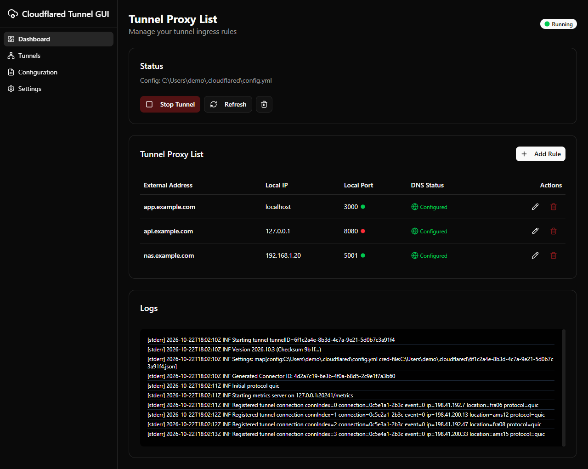
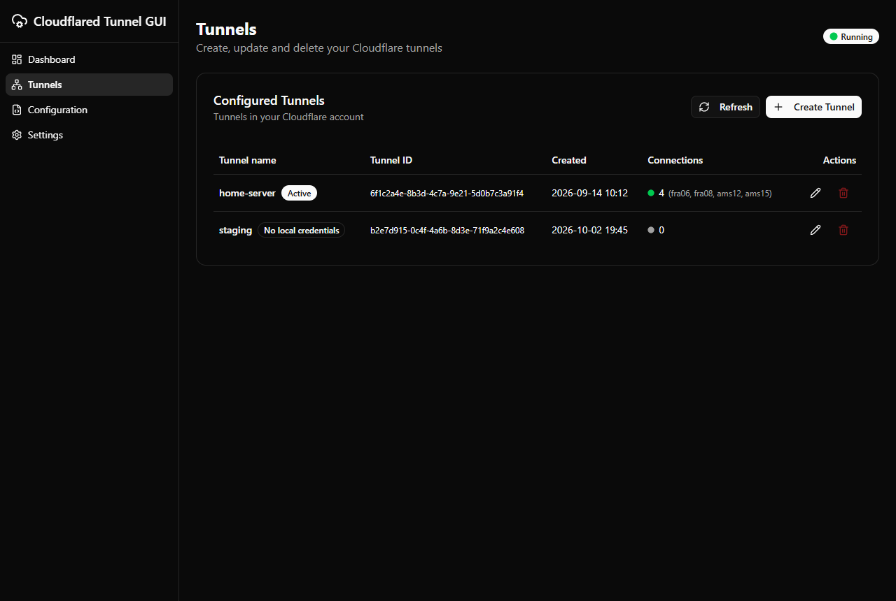
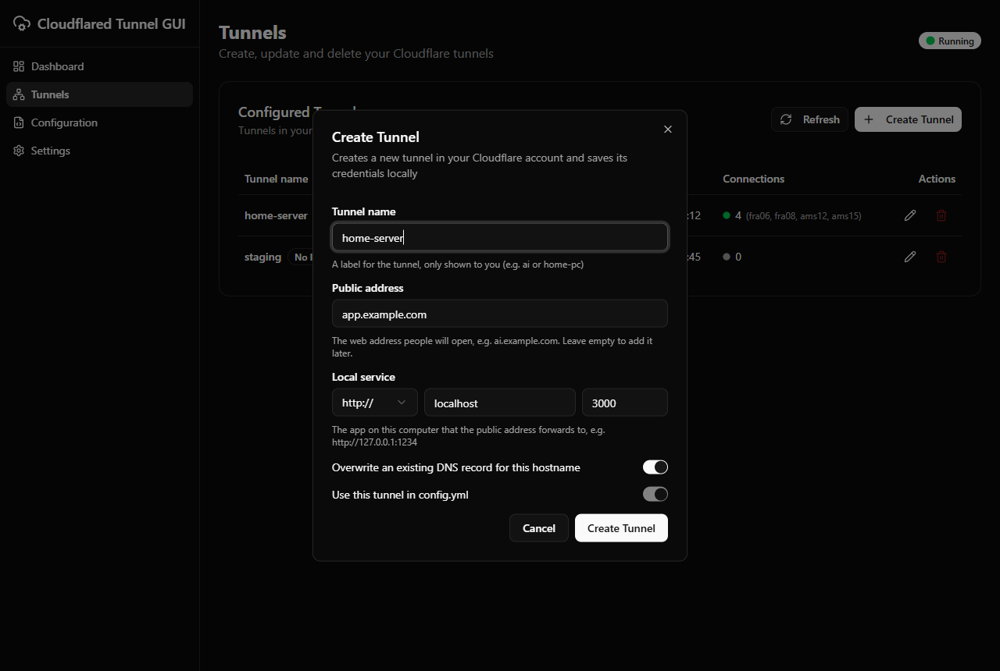
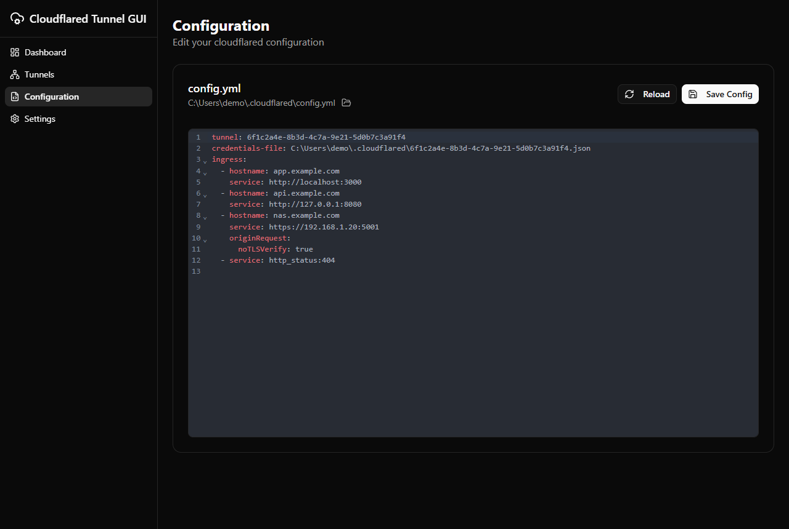
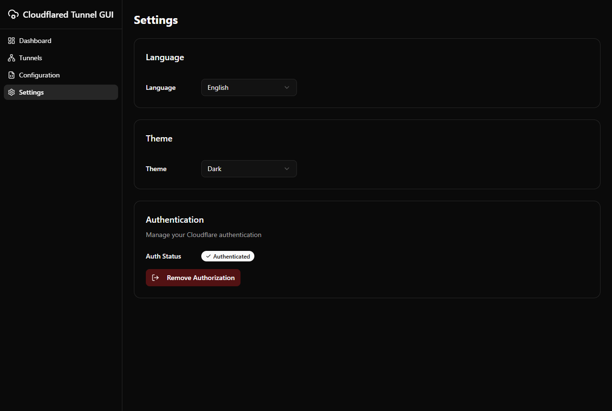

# Cloudflared Tunnel GUI

> ⚠️ **Note**: This project was created through vibe coding (AI-assisted development). The original Electron version was tested on macOS; the Tauri version has been tested on Windows 11.

A lightweight desktop GUI (Tauri + React + Vite) for managing Cloudflare Tunnel (`cloudflared`) runtime and editing your local `~/.cloudflared/config.yml` ingress rules.

## Screenshots

| Dashboard | Tunnels |
|:---------:|:-------:|
|  |  |

| Create tunnel | Configuration | Settings |
|:-------------:|:-------------:|:--------:|
|  |  |  |

## Features

- Start/stop `cloudflared tunnel run` and view live logs
- Manage tunnels: list the tunnels in your Cloudflare account with their live connections, and create, update or delete them
- Create a tunnel together with its public hostname and local service (`http://` or `https://`, with optional self-signed certificate support); the DNS record is created automatically
- Manage ingress rules via a simple form UI, with a live status for each local service and DNS record
- Read/edit your `~/.cloudflared/config.yml` (YAML), with automatic backups
- The running tunnel is restarted automatically when its configuration changes
- Minimize to the system tray (Windows/Linux)
- Cloudflare authentication: trigger `cloudflared tunnel login` and show auth status
- 12 languages: English, 简体中文, 繁體中文, Español, 日本語, Português (Brasil), Deutsch, Français, Русский, 한국어, Hrvatski, Srpski
- Light, dark and system themes

## Prerequisites

- Node.js (recommended: modern LTS)
- pnpm
- [Rust](https://rustup.rs) (stable)
- On Windows: Visual Studio C++ Build Tools and WebView2 (preinstalled on Windows 10/11)
- `cloudflared` installed
  - macOS (Homebrew): `brew install cloudflare/cloudflare/cloudflared`
  - Windows: `winget install --id Cloudflare.cloudflared`
  - Or download from Cloudflare and ensure `cloudflared` is executable

## Development

```bash
pnpm install
pnpm tauri:dev
```

This starts the Vite dev server and opens the app once the Rust backend is compiled.

## Build

```bash
pnpm install
pnpm tauri:build
```

Installers are produced under `src-tauri/target/release/bundle/`.

## Project layout

- `src/` - React UI (pages, components, translations in `src/locales/`)
- `src/lib/tauri-bridge.ts` - exposes the Tauri commands to the UI as `window.api`
- `src-tauri/` - Rust backend: runs `cloudflared`, edits `config.yml`, tray icon

## How configuration is handled

- Config file path: `~/.cloudflared/config.yml`
- The app reads the config on startup.
- When you add/edit/delete rules in the UI, the app updates `ingress` and saves the file.
- The app creates `~/.cloudflared/` if it does not exist and backs up existing config before saving.

## Troubleshooting

- **"cloudflared not found"**
  - Ensure `cloudflared` is installed and available in `PATH`.
  - Restart the app after installing.

- **Tunnel fails to start**
  - Check the log panel in Dashboard.
  - Validate your `config.yml` is valid YAML and `ingress` rules are correct.
